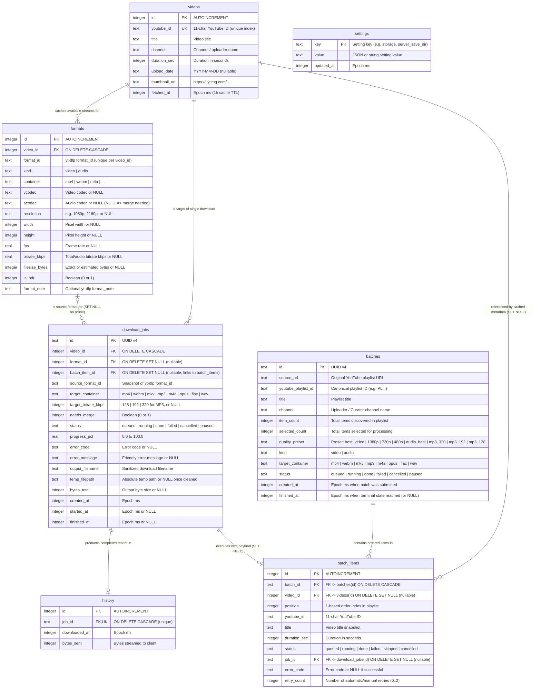

# RetroTube — Entity-Relationship Model (ER)

> **Status:** Design Document (Phase 2 — Playlist Support & Big-Video Reliability)  
> **Database Engine:** SQLite 3 (`better-sqlite3`, `PRAGMA foreign_keys = ON`, `PRAGMA journal_mode = WAL`)

---

## 1. ER Diagram

---

## 2. Relationships & Referential Integrity

| Parent Entity   | Child Entity    | Cardinality | Foreign Key & `ON DELETE` Action                                    | Rationale                                                                                                                                                                                                                  |
| :-------------- | :-------------- | :---------- | :------------------------------------------------------------------ | :------------------------------------------------------------------------------------------------------------------------------------------------------------------------------------------------------------------------- |
| `batches`       | `batch_items`   | `1 : N`     | `batch_items.batch_id -> batches.id` (`ON DELETE CASCADE`)          | Batch items strictly belong to a batch run; deleting a batch cascades to all its item records.                                                                                                                             |
| `videos`        | `batch_items`   | `0..1 : N`  | `batch_items.video_id -> videos.id` (`ON DELETE SET NULL`)          | If a cached video entry expires or is pruned, batch item records remain intact for history and reporting.                                                                                                                  |
| `download_jobs` | `batch_items`   | `0..1 : 1`  | `batch_items.job_id -> download_jobs.id` (`ON DELETE SET NULL`)     | Batch items delegate physical downloading to a `download_jobs` worker execution. If a job is pruned, the item keeps its status and metadata.                                                                              |
| `batch_items`   | `download_jobs` | `0..1 : 1`  | `download_jobs.batch_item_id -> batch_items.id` (`ON DELETE SET NULL`) | Two-way cross-reference allows download job workers to locate parent batch item context directly without redundant table scans.                                                                                            |
| `videos`        | `formats`       | `1 : N`     | `formats.video_id -> videos.id` (`ON DELETE CASCADE`)               | Formats belong strictly to a video snapshot; removing a video cleans up its formats.                                                                                                                                       |
| `videos`        | `download_jobs` | `1 : N`     | `download_jobs.video_id -> videos.id` (`ON DELETE CASCADE`)         | Every job targets a known video; deleting a video cascades to its jobs.                                                                                                                                                    |
| `formats`       | `download_jobs` | `0..1 : N`  | `download_jobs.format_id -> formats.id` (`ON DELETE SET NULL`)      | Refreshing a video's format list after the 1h TTL expires must **not** cascade-delete past `download_jobs` or `history` rows if YouTube drops an old format ID. `source_format_id` preserves the snapshot for re-download. |
| `download_jobs` | `history`       | `1 : 0..1`  | `history.job_id -> download_jobs.id` (`ON DELETE CASCADE`)          | Only completed & streamed jobs create a history record; deleting a job cascades to its history entry.                                                                                                                      |
| `settings`      | _(standalone)_  | `—`         | `—`                                                                 | Key-value persistence for app preferences and storage thresholds.                                                                                                                                                          |

---

## 3. Data Retention & Lifecycle Notes

1. **Batch Lifecycle & Items:**
   - Batches are created via `POST /api/batch`. Each item starts in `queued` state.
   - Items execute through the batch worker with `BATCH_CONCURRENCY` (default 1, max 3) respecting global `MAX_CONCURRENT_JOBS`.
   - Items that fail due to transient errors (network timeout, rate limit) are retried up to 2 times (`retry_count <= 2`) with exponential backoff before transitioning to `failed`.
   - Unavailable or deleted items in a playlist are marked `skipped` with error code `ITEM_UNAVAILABLE` without failing the entire batch.
   - When all items reach a terminal state (`done`, `failed`, `skipped`, `cancelled`), the batch transitions to `done` (or `cancelled` if aborted).
2. **Resumable Downloads & Paused States:**
   - Both `download_jobs` and `batches` support a `paused` state (e.g. triggered by pre-flight disk guard `INSUFFICIENT_DISK` or server shutdown).
   - Partial file downloads (`.part` files) are preserved on disk. When resumed, `yt-dlp` runs with `--continue` to resume downloading from the existing byte offset rather than restarting from zero.
3. **ZIP Delivery & Retention:**
   - Batch completions offer on-the-fly streaming ZIP (`GET /api/batch/[id]/zip`) using `STORE` mode (zero compression) with `ZIP64` extensions.
   - No temporary ZIP archive is created on disk. Files remain on disk in `TEMP_DIR` until `FILE_TTL_MINUTES` (default 120 minutes) expires or until the user triggers a cleanup.
4. **History Cap:** Single-video and batch item history queries return at most 50 newest entries (`ORDER BY downloaded_at DESC LIMIT 50`), pruning records exceeding the 50-item ceiling.
