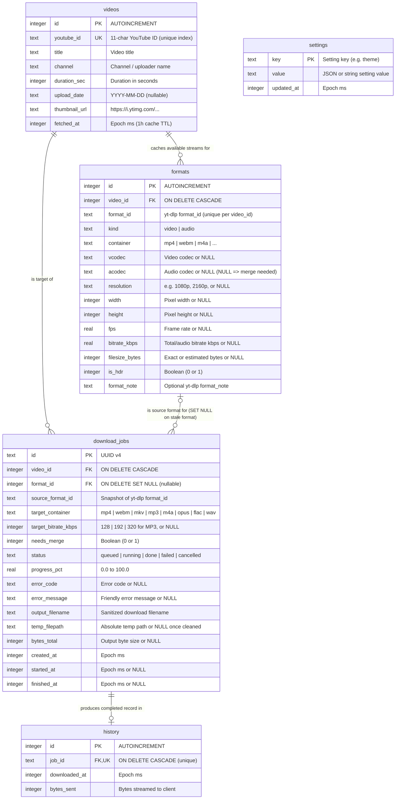

# RetroTube — Entity-Relationship Model (ER)

> **Status:** Design Document (Phase 1)  
> **Database Engine:** SQLite 3 (`better-sqlite3`, `PRAGMA foreign_keys = ON`)

---

## 1. ER Diagram

---

## 2. Relationships & Referential Integrity

| Parent Entity   | Child Entity    | Cardinality | Foreign Key & `ON DELETE` Action                               | Rationale                                                                                                                                                                                                                  |
| :-------------- | :-------------- | :---------- | :------------------------------------------------------------- | :------------------------------------------------------------------------------------------------------------------------------------------------------------------------------------------------------------------------- |
| `videos`        | `formats`       | `1 : N`     | `formats.video_id -> videos.id` (`ON DELETE CASCADE`)          | Formats belong strictly to a video snapshot; removing a video cleans up its formats.                                                                                                                                       |
| `videos`        | `download_jobs` | `1 : N`     | `download_jobs.video_id -> videos.id` (`ON DELETE CASCADE`)    | Every job targets a known video; deleting a video cascades to its jobs.                                                                                                                                                    |
| `formats`       | `download_jobs` | `0..1 : N`  | `download_jobs.format_id -> formats.id` (`ON DELETE SET NULL`) | Refreshing a video's format list after the 1h TTL expires must **not** cascade-delete past `download_jobs` or `history` rows if YouTube drops an old format ID. `source_format_id` preserves the snapshot for re-download. |
| `download_jobs` | `history`       | `1 : 0..1`  | `history.job_id -> download_jobs.id` (`ON DELETE CASCADE`)     | Only completed & streamed jobs create a history record; deleting a job cascades to its history entry.                                                                                                                      |
| `settings`      | _(standalone)_  | `—`         | `—`                                                            | Key-value persistence for lightweight app preferences.                                                                                                                                                                     |

---

## 3. Data Retention & Lifecycle Notes

1. **Metadata Cache (`videos` + `formats`):** Upserted on `POST /api/fetch`. When `now - fetched_at < CACHE_TTL_SECONDS * 1000` (default `3600000 ms`), cached rows are served without spawning `yt-dlp`. On refresh, existing `(video_id, format_id)` rows are updated in place to preserve `formats.id` primary keys, and obsolete format rows are pruned (`download_jobs.format_id` becomes `NULL` via `ON DELETE SET NULL`).
2. **History Cap (Last 50):** `history` queries return at most 50 newest entries (`ORDER BY downloaded_at DESC LIMIT 50`), and inserts prune entries older than the newest 50 rows.
3. **Temp File Pointers (`download_jobs.temp_filepath`):** Cleared (`NULL`) when the temp file is deleted after streaming, cancellation, failure, or the 30-minute sweeper.
