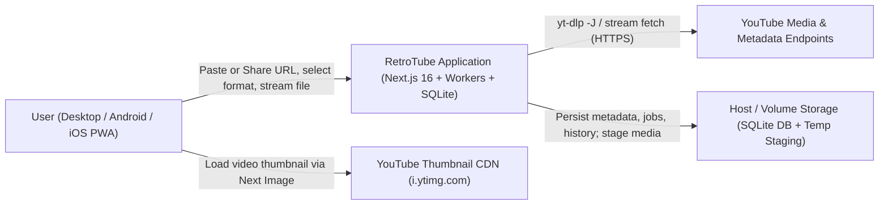
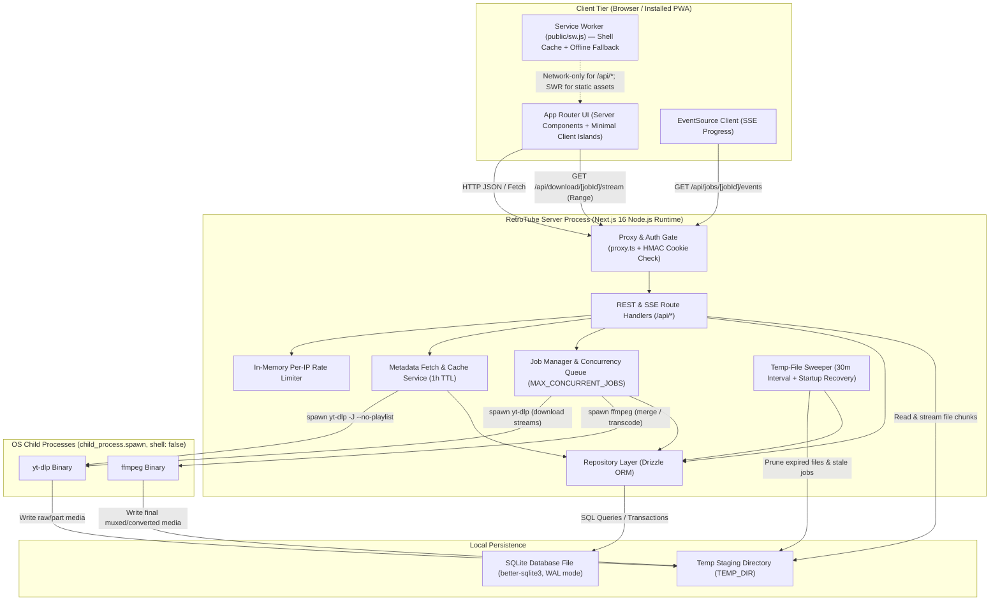
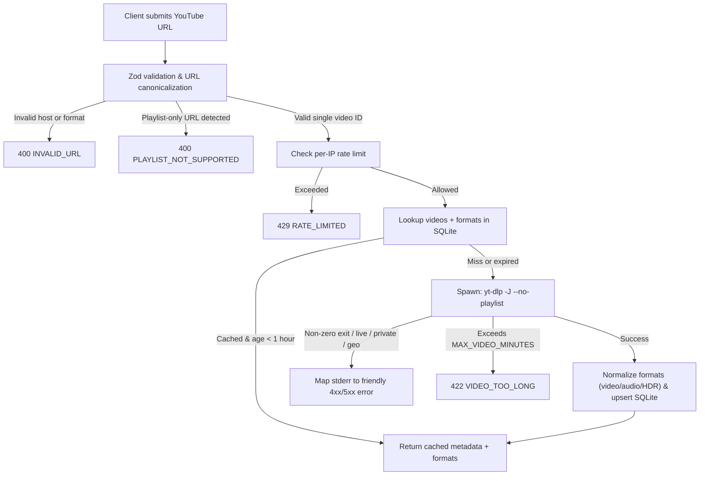
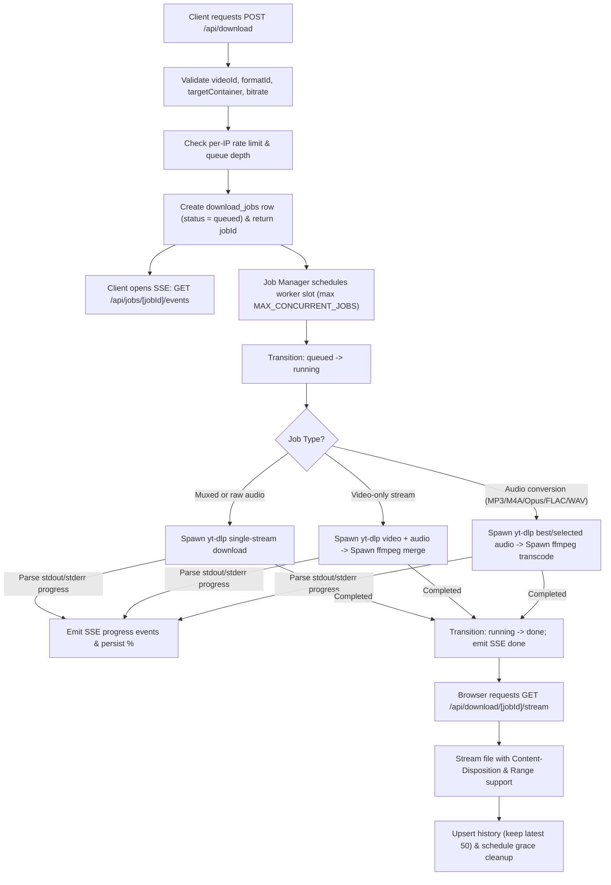
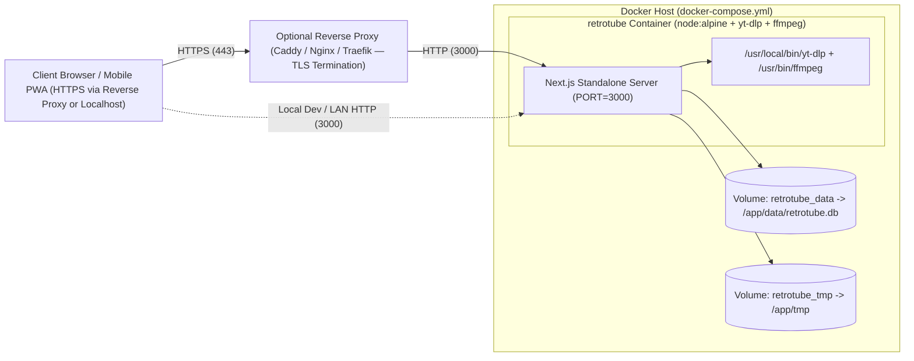

# RetroTube — High-Level Design (HLD)

> **Status:** Design Document (Phase 1)  
> **Target Stack:** Next.js 16 (App Router, Node.js runtime), TypeScript (strict), Tailwind CSS, SQLite (`better-sqlite3` + Drizzle ORM), `yt-dlp`, `ffmpeg`, Zod

---

## 1. Overview

**RetroTube** is a lightweight, self-hostable, personal-use Progressive Web App (PWA) for inspecting YouTube single-video metadata and downloading any available video or audio quality—including automatically merging video-only high-resolution streams with best audio and converting audio streams into MP3 (128/192/320 kbps), M4A, Opus, FLAC, or WAV.

The system is intentionally zero-ops: a single Next.js Node.js process manages web rendering, REST/SSE APIs, a bounded child-process worker queue (`yt-dlp` and `ffmpeg` via `child_process.spawn`), a single-file SQLite database, and a local temporary staging directory.

---

## 2. System Context Diagram

---

## 3. Container Diagram

---

## 4. Core Request Flows

### 4.1 Metadata Fetch Flow (`POST /api/fetch`)

### 4.2 Download, Merge/Convert, and Stream Flow

---

## 5. Non-Functional Requirements

### 5.1 Performance & Resource Targets

- **Client Bundle Budget:** First-load JS `< 100 KB` gzipped by keeping pages as React Server Components and isolating interactive state (URL form, format tabs, SSE job progress) into tiny Client Components with zero UI kits or state libraries.
- **Lighthouse Targets (Mobile):** `>= 95` across Performance, Accessibility, Best Practices, and SEO; installable PWA criteria satisfied.
- **Streaming Efficiency:** Completed media files are streamed directly from disk using `fs.createReadStream` mapped to Web `ReadableStream` with HTTP `Range` (`206 Partial Content`) support so large 4K/8K files never buffer into Node.js heap.
- **Metadata Caching:** Valid video metadata and format lists are cached in SQLite for 1 hour (`CACHE_TTL_SECONDS=3600`) to prevent repeated `yt-dlp -J` cold launches.

### 5.2 Security

- **SSRF & URL Allowlist:** Only `youtube.com`, `www.youtube.com`, `m.youtube.com`, `music.youtube.com`, `youtu.be`, and `www.youtu.be` over `http:`/`https:` (no credentials, no arbitrary ports) are accepted. A strict 11-character YouTube ID (`[A-Za-z0-9_-]{11}`) is extracted and reconstructed into a canonical URL before invoking `yt-dlp`.
- **Command Injection Immunity:** `yt-dlp` and `ffmpeg` are invoked exclusively via `child_process.spawn(binary, argsArray, { shell: false })`. User input is never interpolated into shell strings.
- **Filename Sanitization & Header Safety:** Downloaded filenames strip path separators, control characters, quotes, and Windows/macOS reserved characters, providing both ASCII fallback and RFC 5987 `filename*=UTF-8''...` in `Content-Disposition`.
- **Optional Password Gate:** Controlled by `APP_PASSWORD`. Disabled by default; when set, `POST /api/auth/login` verifies credentials using `crypto.timingSafeEqual` and issues an `HttpOnly`, `SameSite=Strict` HMAC-SHA256 signed session cookie enforced across pages (`proxy.ts`) and API routes.
- **Abuse Controls:** Sliding-window per-IP rate limiter (`RATE_LIMIT_FETCH_PER_MIN`, `RATE_LIMIT_DOWNLOAD_PER_MIN`), job concurrency cap (`MAX_CONCURRENT_JOBS=2`), bounded queue size, and video duration ceiling (`MAX_VIDEO_MINUTES=180`).

### 5.3 Observability

- **Structured JSON Logs:** Single-line JSON logs to `stdout`/`stderr` containing `timestamp`, `level`, `requestId`, `jobId` (when applicable), `route`, `durationMs`, and `errorCode`. Sensitive headers/cookies/passwords are never logged.
- **Central Error Mapping:** Every API route funnels errors through a central error formatter returning consistent `{ error: { code, message, requestId, details? } }` payloads.
- **Health Endpoint:** `GET /api/health` verifies SQLite connectivity (`SELECT 1`), temp directory writability, and availability of `yt-dlp` and `ffmpeg` binaries.

### 5.4 Scalability & Operational Envelope

- **Single-Instance Design:** Optimized for personal / small-household deployment on a single host or container. SQLite runs in `WAL` mode (`busy_timeout = 5000`), and job coordination/rate limiting reside in-process without external broker infrastructure.
- **Disk Hygiene:** Temp files are deleted immediately after full stream completion/abort (or after a 60-second grace window on partial `Range` probes), immediately upon job failure/cancellation, on server boot (orphan purge), and by a 30-minute background sweeper.

---

## 6. Deployment Diagram

---

## 7. Architecture Decision Records (ADRs)

### ADR-001: SQLite (`better-sqlite3` + Drizzle ORM) over PostgreSQL / Redis

- **Context:** RetroTube is a personal-use single-node tool requiring zero external database administration.
- **Decision:** Use synchronous `better-sqlite3` wrapped with Drizzle ORM (`WAL` mode + `foreign_keys = ON`) for persistence, and in-process data structures for ephemeral rate limiting and job progress pub/sub.
- **Trade-offs:** Zero operational overhead and single-volume backup; constrains horizontal multi-replica scaling (acceptable for personal use).

### ADR-002: `child_process.spawn` with Argument Arrays over Shell Execution

- **Context:** Passing arbitrary URLs or metadata strings through `/bin/sh` creates command injection risks.
- **Decision:** Always call `spawn(bin, args, { shell: false })` with canonicalized YouTube URLs and validated format IDs.
- **Trade-offs:** Slightly more verbose stream/process orchestration, complete immunity to shell metacharacter injection.

### ADR-003: Temp-File Staging + HTTP Range Streaming over Direct `stdout` Piping

- **Context:** Merging video+audio (`ffmpeg` MP4 muxing requires seekable output for the `moov` atom) and audio transcoding cannot always stream cleanly over stdout pipes, and mobile browsers often probe downloads using HTTP `Range` requests.
- **Decision:** Stage output in `TEMP_DIR/<jobId>.<ext>`, emit real progress over SSE (`/api/jobs/[jobId]/events`), then stream from disk via `GET /api/download/[jobId]/stream` with `Accept-Ranges: bytes`, deleting immediately after full-stream end/abort (with a 60s grace window for partial `Range` probes) and running a 30m sweeper.
- **Trade-offs:** Requires temporary disk space up to video size; guarantees valid seeking/headers, accurate `Content-Length`, Range resumes, and clean error reporting before download begins.

### ADR-004: Monotonic Multi-Stage Pipeline for Merges & Audio Conversions

- **Context:** When `yt-dlp` merges streams via `--merge-output-format`, its stdout progress jumps back to `0%` for the second stream and provides no percentage during `ffmpeg` muxing.
- **Decision:** Execute explicit bounded stages via `spawn`:
  - Direct muxed/audio: `yt-dlp` (`0–100%`)
  - Video-only merge: `yt-dlp` video (`0–60%`) -> `yt-dlp` best audio (`60–85%`) -> `ffmpeg -progress pipe:1` (`85–100%`)
  - Audio conversion: `yt-dlp` audio (`0–60%`) -> `ffmpeg -progress pipe:1` transcode (`60–100%`)
- **Trade-offs:** Slightly more process orchestration code; yields accurate, monotonic SSE progress bars and direct `ffmpeg` codec/bitrate control.

### ADR-005: Minimal Client JS + Hand-Written Service Worker (`public/sw.js`)

- **Context:** Target first-load JS is `< 100 KB` gzipped and Lighthouse PWA/Performance `>= 95`.
- **Decision:** Use Next.js 16 Server Components by default, inline SVGs/CSS for retro cassette/CRT styling, `next/font` for Manrope + self-hosted Satoshi `.woff2`, and a dependency-free `public/sw.js` (`app/manifest.ts` + offline fallback).
- **Trade-offs:** No heavy Workbox abstractions; complete control over caching policies (`network-only` on `/api/*`, `stale-while-revalidate` on static assets).

### ADR-006: Optional HMAC-SHA256 Cookie Gate (`APP_PASSWORD`)

- **Context:** Users deploying RetroTube behind a public URL need lightweight access control without external identity providers.
- **Decision:** When `APP_PASSWORD` is non-empty, guard pages via `proxy.ts` and API routes via shared server session verification using an HMAC-SHA256 signed `HttpOnly` cookie verified with `crypto.timingSafeEqual`. Keep `/api/health`, `/manifest.webmanifest`, `/sw.js`, `/offline`, and `/unlock` public.
- **Trade-offs:** Single shared password rather than multi-user accounts; zero database complexity and zero auth dependencies.
