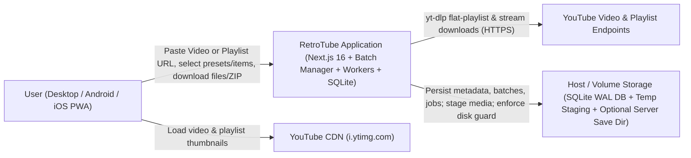
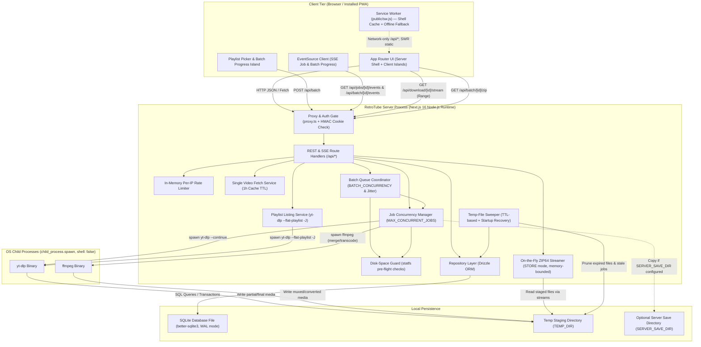
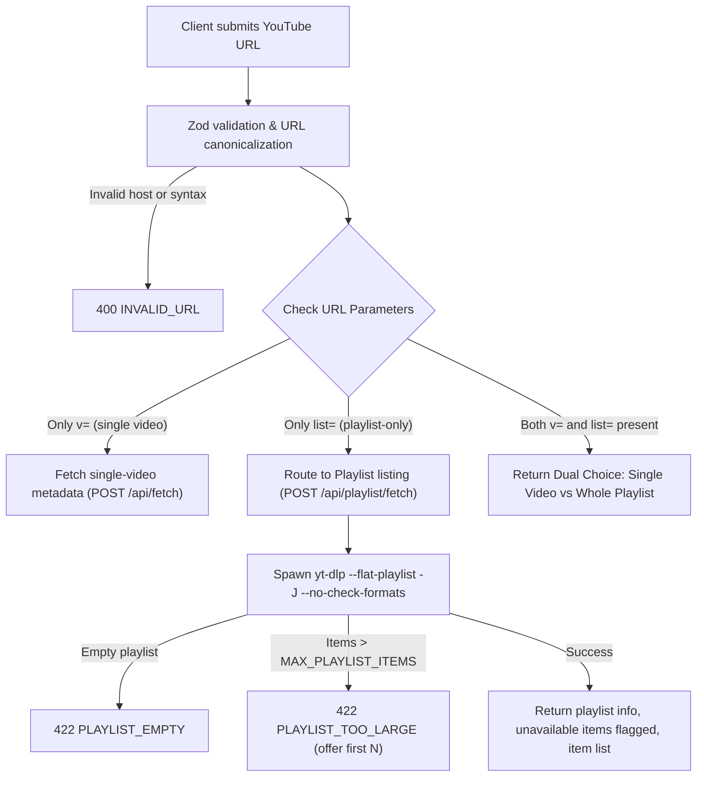
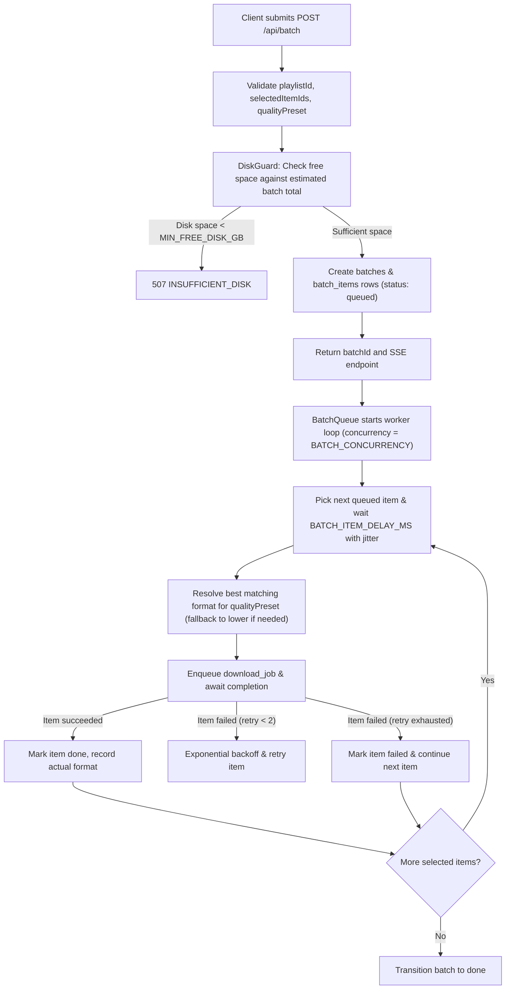
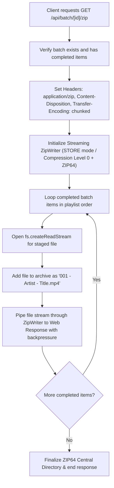

# RetroTube — High-Level Design (HLD)

> **Status:** Design Document (Phase 2 — Playlist Support & Big-Video Reliability)  
> **Target Stack:** Next.js 16 (App Router, Node.js runtime), TypeScript (strict), Tailwind CSS, SQLite (`better-sqlite3` + Drizzle ORM), `yt-dlp`, `ffmpeg`, Zod

---

## 1. Overview

**RetroTube V2** expands upon the lightweight, personal-use media archiver by adding two core pillars:
1. **Full Playlist & Batch Download Support:** Instant listing of playlist metadata via `--flat-playlist`, interactive item selection, quality presets with automatic fallback, bounded concurrent execution (`BATCH_CONCURRENCY`), inter-item delay jitter to avoid rate limits, individual item download links, and on-the-fly streaming uncompressed ZIP (`STORE` mode, ZIP64).
2. **Big-Video Reliability & Storage Guards:** Elimination of arbitrary video length restrictions in favor of soft configurable limits (`MAX_VIDEO_MINUTES`, `MAX_FILE_SIZE_GB`), pre-flight disk space reservation guards (`statfs` check with `MIN_FREE_DISK_GB` floor), backpressure-controlled HTTP Range/206 media streaming, 15-second SSE keepalive pulses for reverse-proxy resilience, stall detection, and resumable partial downloads (`--continue`).

The application retains its zero-ops architecture: a single Next.js Node.js process manages UI rendering, REST/SSE APIs, a bounded child-process worker queue, an embedded SQLite database, and a local temporary staging directory.

---

## 2. System Context Diagram

---

## 3. Container Diagram

---

## 4. Core Request Flows

### 4.1 Single Video vs. Playlist Detection Flow (`POST /api/fetch` & `POST /api/playlist/fetch`)

### 4.2 Batch Queue & Preset Fallback Flow (`POST /api/batch`)

### 4.3 On-the-Fly Streaming ZIP Delivery (`GET /api/batch/[id]/zip`)

---

## 5. Non-Functional Requirements

### 5.1 Performance & Resource Targets

- **Streaming Memory Efficiency:** Media streaming (`GET /api/download/[id]/stream`) and ZIP generation (`GET /api/batch/[id]/zip`) use Node.js Streams piped directly to Web `ReadableStream` instances. Heap memory overhead remains bounded `< 10 MB` even when serving multi-gigabyte files or 4 GB+ ZIP archives.
- **Fast Playlist Listing:** `POST /api/playlist/fetch` invokes `yt-dlp` with `--flat-playlist -J --no-check-formats --skip-download`, fetching metadata for 100+ items in ~1.5–2.5 seconds without probing video stream URLs up front.
- **Client Bundle Budget:** Core home bundle `< 100 KB` gzipped. Playlist and Batch islands are loaded dynamically.
- **ZIP64 Compliance:** On-the-fly streaming ZIP uses ZIP64 extensions to support playlists exceeding 4 GB total uncompressed size and > 65,535 files without truncation or file corruption.

### 5.2 Reliability & Storage Controls

- **Disk-Space Guard:** Before starting single downloads or batch items, `DiskGuard` executes a `statfs` syscall on `TEMP_DIR`.
  - Merges (`video + audio`): requires `filesize_bytes * 2.2`.
  - Direct downloads / audio conversions: requires `filesize_bytes * 1.2`.
  - Refuses execution with `507 INSUFFICIENT_DISK` if free space drops below `MIN_FREE_DISK_GB` (default 5 GB).
- **Resumable Downloads:** `yt-dlp` is configured with `--continue`, retrying dropped HTTP connections and picking up from partial `.part` files on disk rather than restarting downloads from 0%.
- **SSE Keepalive:** Every 15 seconds, SSE connections emit `: keepalive\n\n` comments to prevent reverse proxies (Nginx, Traefik, Cloudflare tunnels) from dropping idle connections.
- **Extended TTL for Big Files:** Downloaded files are retained for `FILE_TTL_MINUTES` (default 120 minutes) to accommodate slow cellular downloads before cleanup.

---

## 6. Architecture Decision Records (ADRs)

### ADR-001: SQLite (`better-sqlite3` + Drizzle ORM) *(Retained from V1)*
Synchronous embedded SQLite in WAL mode with foreign keys enabled provides robust local persistence without operational overhead.

### ADR-002: `child_process.spawn` with Argument Arrays *(Retained from V1)*
Zero shell interpolation guarantees complete immunity from command injection vulnerabilities.

### ADR-003: Temp-File Staging + HTTP Range Streaming *(Retained from V1)*
Media is staged to disk to ensure valid `moov` atom placement, seekability, and accurate `Content-Length`.

### ADR-004: Monotonic Multi-Stage Pipeline for Merges *(Retained from V1)*
Explicit staged process execution guarantees monotonically increasing progress percentages for SSE updates.

### ADR-005: Minimal Client JS + Hand-Written Service Worker *(Retained from V1)*
Zero external UI component libraries; hand-crafted service worker for predictable caching and offline support.

### ADR-006: Optional HMAC-SHA256 Cookie Gate *(Retained from V1)*
Lightweight single-password protection for exposed web instances without requiring third-party auth services.

### ADR-007: On-the-fly STORE Mode ZIP64 Streaming vs Temp Archive on Disk *(New in V2)*

- **Context:** Delivering 50–200 downloaded playlist tracks to a user as a single download can be done by (a) building a giant `.zip` file on disk first, (b) forcing the user to click 50 download links, or (c) streaming a ZIP archive on the fly.
- **Decision:** Stream a ZIP archive dynamically using `STORE` mode (compression level 0) and `ZIP64` extensions directly from the staged media files into the HTTP response.
- **Rationale:**
  1. Media files (`.mp4`, `.mp3`, `.webm`, `.opus`) are already compressed. Applying Deflate compression wastes CPU cycles and slows down delivery. `STORE` mode requires near-zero CPU.
  2. Building an intermediate ZIP file on disk would double the disk space requirement (e.g. 5 GB of video + 5 GB ZIP = 10 GB disk usage). On-the-fly streaming uses 0 additional disk bytes.
  3. Node.js stream backpressure ensures server RAM usage stays under 10 MB even for 10 GB+ archives.
- **Trade-offs:** Browser cannot know the exact total ZIP `Content-Length` in advance without a pre-scan (uses `Transfer-Encoding: chunked`), but downloads start instantly without waiting for compression.

### ADR-008: Temp-File Staging with Range/206 Streaming for Big Files over In-Memory Buffering *(New in V2)*

- **Context:** Long YouTube videos (podcasts, livestreams, concert recordings) can range from 500 MB to 10+ GB. Buffering media in memory or attempting to pipe unseekable live stdout streams to the client causes out-of-memory crashes and broken MP4 playback.
- **Decision:** Always download and process large files directly to `TEMP_DIR` on disk first. Once verified, serve them using Node.js file read streams with standard HTTP `Range` (`206 Partial Content`) support, while enforcing pre-flight disk reservation checks.
- **Rationale:**
  1. MP4 files require seekable moov atom faststart headers to play smoothly and allow seeking. Piping live stdout to the browser prevents faststart optimization and breaks media player scrubbing.
  2. HTTP Range support allows browsers, mobile players, and download managers to pause, resume, and seek without re-downloading earlier bytes.
  3. Pre-flight `statfs` disk checking prevents filling up the host volume mid-download.
- **Trade-offs:** Requires disk space on the host proportional to media size until TTL cleanup, mitigated by automatic sweeper and storage management dashboard.
