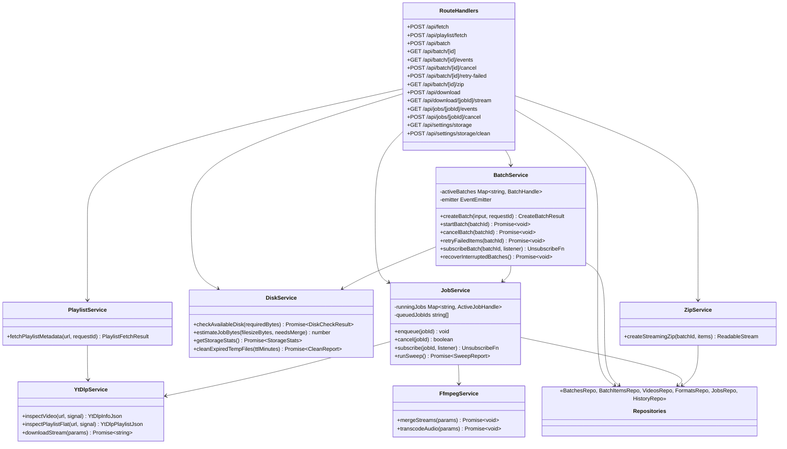
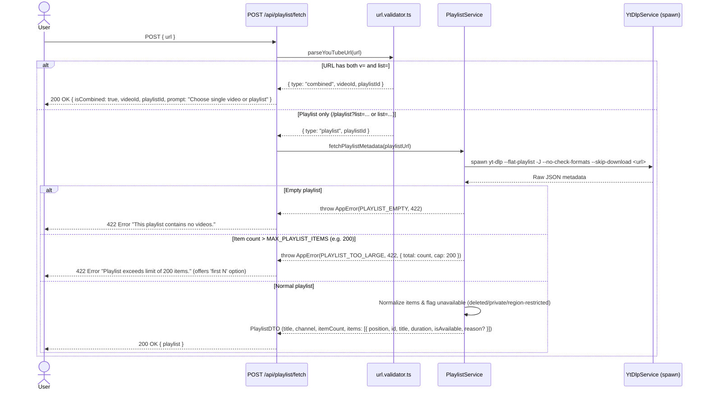
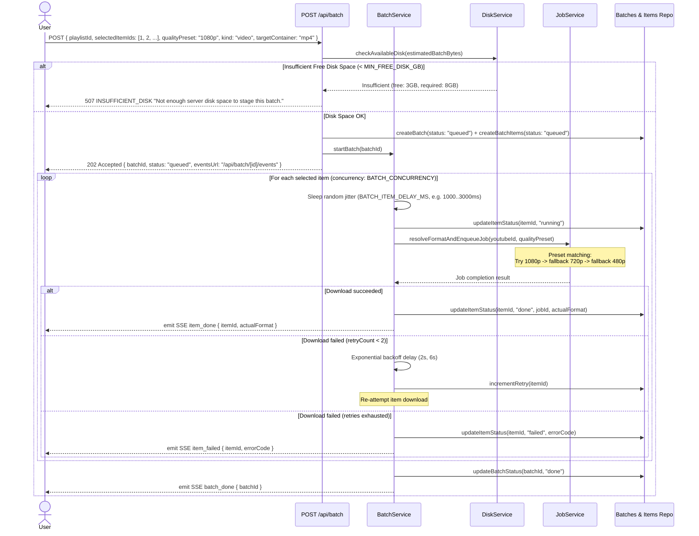
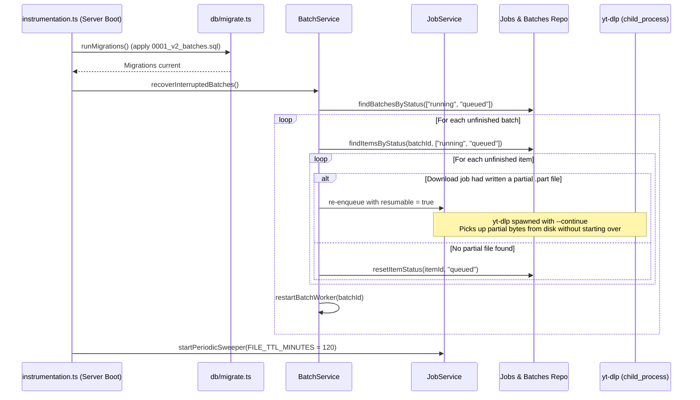
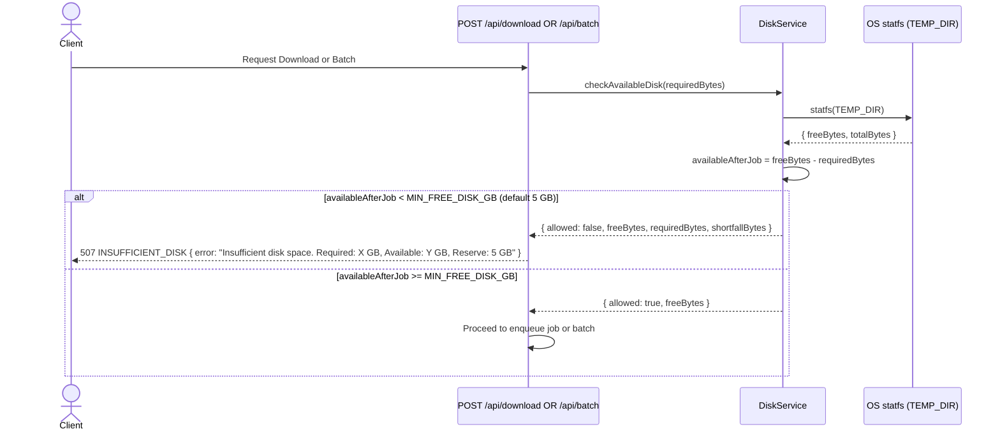
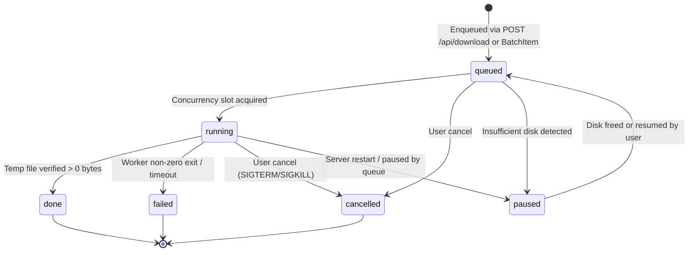
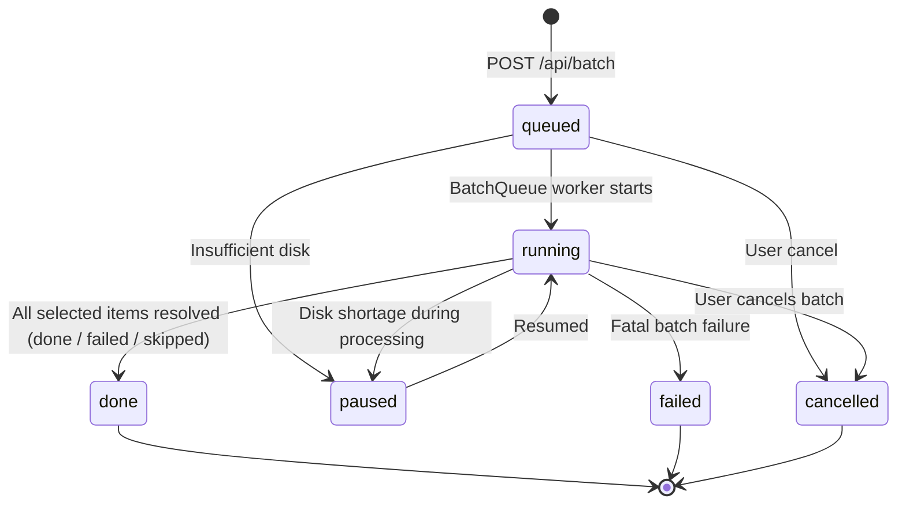
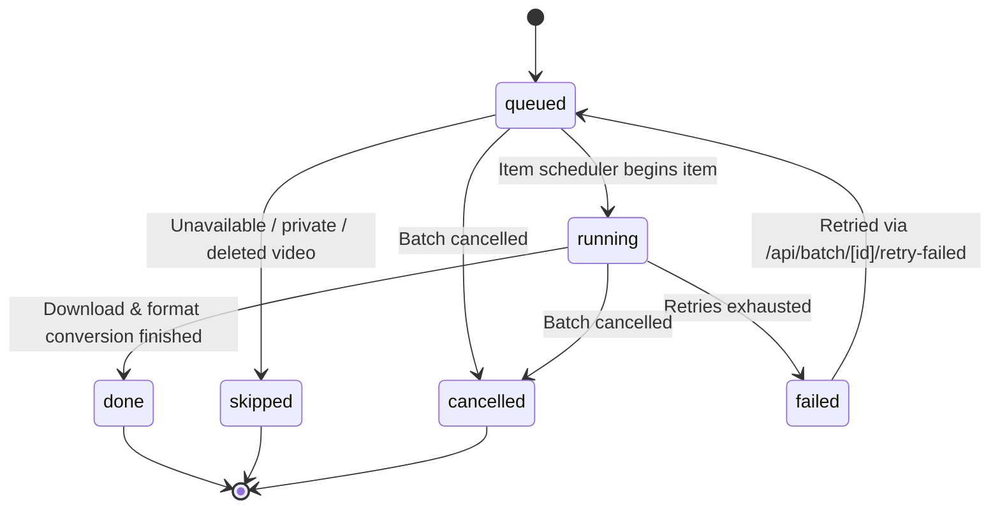

# RetroTube — Low-Level Design (LLD)

> **Status:** Design Document (Phase 2 — Playlist Support & Big-Video Reliability)  
> **Architecture Pattern:** Layered Next.js App Router (`Route Handlers -> Services -> Repositories -> SQLite / Child Processes / Streaming Engines`)

---

## 1. Folder Structure

```text
kisni/
├── app/
│   ├── layout.tsx                      # Root layout: Manrope + Satoshi fonts, PWA meta, safe-area
│   ├── globals.css                     # Tailwind tokens, Warm Cream theme, halftone/grain
│   ├── page.tsx                        # Main screen (Server shell + Video/Playlist/Batch Client Islands)
│   ├── history/
│   │   └── page.tsx                    # Download history view (Single videos & Batch runs)
│   ├── offline/
│   │   └── page.tsx                    # PWA offline fallback ("Tape not found")
│   ├── manifest.ts                     # Dynamic Web App Manifest (shortcuts, share_target)
│   └── api/
│       ├── health/route.ts             # GET  /api/health
│       ├── fetch/route.ts              # POST /api/fetch (Single video fetch)
│       ├── playlist/
│       │   └── fetch/route.ts          # POST /api/playlist/fetch (Fast flat listing)
│       ├── download/
│       │   ├── route.ts                # POST /api/download (Single job creation)
│       │   └── [jobId]/stream/route.ts # GET  /api/download/[jobId]/stream (Range + Content-Disposition)
│       ├── jobs/
│       │   └── [jobId]/
│       │       ├── events/route.ts     # GET  /api/jobs/[jobId]/events (SSE progress)
│       │       └── cancel/route.ts     # POST /api/jobs/[jobId]/cancel
│       ├── batch/
│       │   ├── route.ts                # POST /api/batch (Create & start batch)
│       │   └── [id]/
│       │       ├── route.ts            # GET /api/batch/[id] & DELETE /api/batch/[id]
│       │       ├── events/route.ts     # GET /api/batch/[id]/events (SSE batch & item progress)
│       │       ├── cancel/route.ts     # POST /api/batch/[id]/cancel
│       │       ├── retry-failed/route.ts # POST /api/batch/[id]/retry-failed
│       │       └── zip/route.ts        # GET /api/batch/[id]/zip (On-the-fly STORE ZIP64)
│       ├── history/
│       │   ├── route.ts                # GET  /api/history
│       │   └── [id]/route.ts           # DELETE /api/history/[id]
│       └── settings/
│           └── storage/
│               ├── route.ts            # GET  /api/settings/storage (Free space, temp stats)
│               └── clean/route.ts      # POST /api/settings/storage/clean (Manual sweep)
├── proxy.ts                            # Next.js 16 Proxy: requestId injection
├── instrumentation.ts                  # Server boot: run migrations, recover interrupted batches, start sweeper
├── db/
│   ├── schema.ts                       # Drizzle SQLite tables (videos, formats, batches, batch_items, jobs, history)
│   ├── client.ts                       # Singleton better-sqlite3 connection (WAL, foreign_keys=ON)
│   └── migrate.ts                      # Programmatic Drizzle migration runner on startup
├── drizzle/
│   ├── 0000_ambitious_epoch.sql        # V1 baseline migration
│   └── 0001_v2_batches.sql             # V2 incremental migration (batches, batch_items, job references)
├── repositories/
│   ├── videos.repo.ts                  # Upsert/find videos by youtube_id or id
│   ├── formats.repo.ts                 # Upsert/prune/list formats for video_id
│   ├── jobs.repo.ts                    # Create/read/transition download_jobs & mark interrupted
│   ├── batches.repo.ts                 # Create/update batches, track overall status & finish timestamps
│   ├── batch-items.repo.ts             # Upsert/query batch items, track position, retries, and errors
│   ├── history.repo.ts                 # Upsert history, list newest 50, delete by id
│   └── settings.repo.ts                # Get/set key-value settings & storage preferences
├── services/
│   ├── ytdlp.service.ts                # spawn yt-dlp: -J, --flat-playlist, stream download, --continue
│   ├── ffmpeg.service.ts               # spawn ffmpeg: copy muxing, audio transcode + progress parsing
│   ├── format.normalizer.ts            # Pure yt-dlp format JSON -> normalized DTOs & quality preset matcher
│   ├── fetch.service.ts                # Single-video validation, 1h cache, normalization, DB sync
│   ├── playlist.service.ts             # Fast flat playlist fetch, availability tagging, cap enforcement
│   ├── job.service.ts                  # Single-job queue, progress EventEmitter, stall detector, cancel kill
│   ├── batch.service.ts                # Batch coordinator: BATCH_CONCURRENCY, item jitter, retry backoff
│   ├── download.service.ts             # Job creation, Range stream descriptor, temp cleanup
│   ├── zip.service.ts                  # On-the-fly STORE mode streaming ZIP64 archive generator
│   ├── disk.service.ts                 # statfs disk space estimation, reservation check, storage stats
│   ├── history.service.ts              # History listing, deletion, re-download helpers
│   └── health.service.ts               # SQLite, TEMP_DIR, disk space, yt-dlp, ffmpeg readiness checks
├── lib/
│   ├── env.ts                          # Zod environment configuration (batch & disk limits)
│   ├── logger.ts                       # Structured JSON logger with requestId, jobId, batchId
│   ├── errors.ts                       # AppError hierarchy, ErrorCode enum, central error mapper
│   ├── url.validator.ts                # YouTube URL parser: detects video vs playlist vs combined (v= + list=)
│   ├── filename.ts                     # Content-Disposition & ZIP numbered filename sanitizer
│   ├── rate-limiter.ts                 # Sliding-window in-memory per-IP rate limiter
│   └── http.ts                         # Request context helper (requestId, client IP, JSON errors)
├── components/
│   ├── RetroHeader.tsx                 # Header & nav links
│   ├── FetchWorkspace.tsx              # URL input, dual choice prompt, video/playlist routing
│   ├── FormatResultsPanel.tsx          # Single video metadata, tabs, format list
│   ├── PlaylistPicker.tsx              # Playlist items checklist, range selector, preset chooser
│   ├── BatchProgressPanel.tsx          # Batch progress, per-item rows, retry, ZIP download
│   ├── StorageDashboard.tsx            # Disk space meter, temp usage, clean temp action
│   ├── JobProgressPanel.tsx            # Single video tape-reel loader, tracking progress bar
│   └── HistoryList.tsx                 # History of single and batch downloads
├── public/
│   ├── fonts/Satoshi-*.woff2           # Self-hosted Satoshi 500, 700, 900
│   ├── icons/                          # PWA icons
│   └── sw.js                           # Hand-written Service Worker
├── docs/                               # HLD.md, LLD.md, ER.md, SCHEMA.md, API.md
├── tests/
│   ├── unit/                           # Vitest unit tests (playlist parser, preset fallback, ZIP64, disk guard)
│   └── e2e/                            # Playwright smoke test (playlist -> range select -> batch -> ZIP)
├── Dockerfile
├── docker-compose.yml
└── .env.example
```

---

## 2. Module Breakdown & Class Diagram



---

## 3. Sequence Diagrams

### 3.1 Playlist Fetch Flow (`POST /api/playlist/fetch`)



### 3.2 Batch Queue Processing & Quality Preset Fallback (`POST /api/batch`)



### 3.3 Resume After Server Restart Flow



### 3.4 On-the-Fly Streaming ZIP Delivery (`GET /api/batch/[id]/zip`)

```mermaid
sequenceDiagram
    actor Browser
    participant API as GET /api/batch/[id]/zip
    participant ZS as ZipService
    participant Repo as Batches & Items Repo
    participant FS as Local Staging (TEMP_DIR)

    Browser->>API: GET /api/batch/[id]/zip
    API->>Repo: getBatchWithCompletedItems(batchId)
    Repo-->>API: Batch record + 25 completed items with temp filepaths
    API->>ZS: createStreamingZip(batch, completedItems)
    API-->>Browser: 200 OK (Transfer-Encoding: chunked, Content-Type: application/zip, Content-Disposition: attachment; filename="Playlist_Title.zip")

    loop For each completed item in position order
        ZS->>FS: fs.createReadStream(item.tempFilepath)
        ZS->>ZS: Write ZIP local file header (STORE mode, 0 compression, ZIP64 format)
        ZS->>ZS: Filename formatted as: "001 - Artist - Title.mp4"
        loop Stream file chunks with backpressure
            FS-->>ZS: Chunk data (64 KB)
            ZS-->>Browser: Streamed ZIP chunk
        end
        ZS->>ZS: Write Data Descriptor (CRC-32, uncompressed size, compressed size)
    end
    ZS->>ZS: Write ZIP64 End of Central Directory Record & End of Central Directory Record
    ZS-->>Browser: Final ZIP chunk (stream closed)
```

### 3.5 Disk-Space Guard & Pre-Flight Check



---

## 4. API Contracts

All error responses share the standardized error envelope:

```json
{
  "error": {
    "code": "INSUFFICIENT_DISK",
    "message": "Server does not have sufficient temporary storage for this operation.",
    "requestId": "123e4567-e89b-12d3-a456-426614174000",
    "details": {
      "requiredMb": 4200,
      "availableMb": 2100,
      "reserveMb": 5120
    }
  }
}
```

### 4.1 `POST /api/playlist/fetch`

- **Request:**
  ```json
  { "url": "https://www.youtube.com/playlist?list=PL1234567890abcdef" }
  ```
- **Response (`200 OK` for Playlist):**
  ```json
  {
    "isCombined": false,
    "playlist": {
      "id": "PL1234567890abcdef",
      "title": "Synthwave Favorites",
      "channel": "Retro Curator",
      "itemCount": 24,
      "items": [
        {
          "position": 1,
          "youtubeId": "dQw4w9WgXcQ",
          "title": "Track 01 - Neon Horizon",
          "durationSec": 213,
          "thumbnailUrl": "https://i.ytimg.com/vi/dQw4w9WgXcQ/hqdefault.jpg",
          "isAvailable": true
        },
        {
          "position": 2,
          "youtubeId": "abc123xyz00",
          "title": "[Deleted video]",
          "durationSec": 0,
          "thumbnailUrl": "",
          "isAvailable": false,
          "unavailableReason": "Video was deleted by uploader"
        }
      ]
    }
  }
  ```
- **Response (`200 OK` when URL contains both `v=` and `list=`):**
  ```json
  {
    "isCombined": true,
    "videoId": "dQw4w9WgXcQ",
    "playlistId": "PL1234567890abcdef",
    "prompt": "This link contains both a single video and a playlist. Which would you like to load?"
  }
  ```

---

### 4.2 `POST /api/batch`

- **Request:**
  ```json
  {
    "playlistId": "PL1234567890abcdef",
    "sourceUrl": "https://www.youtube.com/playlist?list=PL1234567890abcdef",
    "title": "Synthwave Favorites",
    "channel": "Retro Curator",
    "selectedItemIds": ["dQw4w9WgXcQ", "xyz987abc11"],
    "qualityPreset": "1080p",
    "kind": "video",
    "targetContainer": "mp4"
  }
  ```
  _Presets supported:_
  - Video: `"best_video"`, `"1080p"`, `"720p"`, `"480p"`
  - Audio: `"audio_best"`, `"mp3_320"`, `"mp3_192"`, `"mp3_128"`, `"m4a"`, `"opus"`, `"flac"`, `"wav"`
- **Response (`202 Accepted`):**
  ```json
  {
    "batchId": "4a7c1e8b-9d2a-4f5c-8e1d-3b7f9a12c45e",
    "status": "queued",
    "itemCount": 24,
    "selectedCount": 2,
    "qualityPreset": "1080p",
    "eventsUrl": "/api/batch/4a7c1e8b-9d2a-4f5c-8e1d-3b7f9a12c45e/events",
    "zipUrl": "/api/batch/4a7c1e8b-9d2a-4f5c-8e1d-3b7f9a12c45e/zip"
  }
  ```

---

### 4.3 `GET /api/batch/[id]`

- **Response (`200 OK`):**
  ```json
  {
    "batch": {
      "id": "4a7c1e8b-9d2a-4f5c-8e1d-3b7f9a12c45e",
      "title": "Synthwave Favorites",
      "channel": "Retro Curator",
      "status": "running",
      "qualityPreset": "1080p",
      "kind": "video",
      "targetContainer": "mp4",
      "itemCount": 24,
      "selectedCount": 2,
      "completedCount": 1,
      "failedCount": 0,
      "createdAt": 1731331200000,
      "finishedAt": null,
      "items": [
        {
          "id": 101,
          "position": 1,
          "youtubeId": "dQw4w9WgXcQ",
          "title": "Track 01 - Neon Horizon",
          "durationSec": 213,
          "status": "done",
          "actualFormat": "1080p (mp4)",
          "downloadUrl": "/api/download/job-uuid-1/stream",
          "filesizeBytes": 104857600
        },
        {
          "id": 102,
          "position": 2,
          "youtubeId": "xyz987abc11",
          "title": "Track 02 - Midnight City",
          "durationSec": 250,
          "status": "running",
          "progressPct": 45.2
        }
      ]
    }
  }
  ```

---

### 4.4 `GET /api/batch/[id]/events` (SSE)

- **Headers:** `Content-Type: text/event-stream; charset=utf-8`, `Cache-Control: no-cache, no-transform`, `Connection: keep-alive`
- **Events:**
  - `event: batch_progress` — overall batch progress percent and counts.
  - `event: item_progress` — progress of active downloading item.
  - `event: item_done` — individual item finished, provides item download link.
  - `event: item_failed` — item failure with error code.
  - `event: batch_done` — entire batch finished, activates ZIP download.
  - `: keepalive\n\n` — periodic comment sent every 15s to keep connections alive through reverse proxies.

---

### 4.5 `POST /api/batch/[id]/cancel` & `POST /api/batch/[id]/retry-failed`

- **`POST /api/batch/[id]/cancel` (`200 OK`):**
  ```json
  { "batchId": "4a7c1e8b-...", "status": "cancelled" }
  ```
- **`POST /api/batch/[id]/retry-failed` (`200 OK`):**
  ```json
  { "batchId": "4a7c1e8b-...", "retryingItemCount": 3, "status": "running" }
  ```

---

### 4.6 `GET /api/batch/[id]/zip`

- **Headers:**
  - `Content-Type`: `application/zip`
  - `Content-Disposition`: `attachment; filename="Synthwave_Favorites.zip"; filename*=UTF-8''Synthwave%20Favorites.zip`
  - `Transfer-Encoding`: `chunked`
  - `Cache-Control`: `no-cache`
- **Behavior:** Streams on-the-fly uncompressed (`STORE` mode) ZIP with ZIP64 extensions from completed item files.

---

### 4.7 `GET /api/settings/storage` & `POST /api/settings/storage/clean`

- **`GET /api/settings/storage` (`200 OK`):**
  ```json
  {
    "storage": {
      "tempDirPath": "/app/tmp",
      "diskTotalBytes": 107374182400,
      "diskFreeBytes": 53687091200,
      "diskUsedBytes": 53687091200,
      "minFreeDiskGb": 5,
      "tempUsageBytes": 12884901888,
      "tempFileCount": 14,
      "runningJobsCount": 1
    }
  }
  ```
- **`POST /api/settings/storage/clean` (`200 OK`):**
  ```json
  {
    "cleaned": true,
    "deletedFilesCount": 8,
    "freedBytes": 10737418240
  }
  ```

---

## 5. Job & Batch State Machine

### 5.1 Single Video Job State Machine



### 5.2 Batch State Machine



### 5.3 Batch Item State Machine



---

## 6. Error Code Catalogue

| Error Code           | HTTP Status | Trigger / Detection                                                  | User-Friendly Message                                                                    |
| :------------------- | :---------- | :------------------------------------------------------------------- | :--------------------------------------------------------------------------------------- |
| `VALIDATION_ERROR`   | `400`       | Zod schema validation failure                                        | Request input is invalid.                                                                |
| `INVALID_URL`        | `400`       | Non-YouTube host or unparseable URL                                  | Please enter a valid YouTube video or playlist link.                                     |
| `PLAYLIST_EMPTY`     | `422`       | Flat playlist inspection returned 0 items                            | This playlist does not contain any videos.                                               |
| `PLAYLIST_TOO_LARGE` | `422`       | Playlist item count exceeds `MAX_PLAYLIST_ITEMS` (default 200)       | Playlist exceeds the maximum allowed item count. Use the 'first N' option to continue.   |
| `ITEM_UNAVAILABLE`   | `404/422`   | Video in playlist is private, deleted, or blocked                    | This video is unavailable and will be skipped.                                           |
| `INSUFFICIENT_DISK`  | `507`       | Staging disk free space below required estimate + `MIN_FREE_DISK_GB` | Server has insufficient disk space to stage this download. Please free storage or clean. |
| `FILE_TOO_LARGE`     | `422`       | Video size exceeds configured `MAX_FILE_SIZE_GB` (when set > 0)      | File exceeds the maximum allowed file size.                                              |
| `TIMEOUT`            | `504`       | Process stall (no progress for N minutes) or max execution duration  | Media processing timed out. Please try again.                                            |
| `JOB_NOT_FOUND`      | `404`       | Unknown `jobId`, `batchId`, or `history` entry                       | The requested job, batch, or history record was not found.                               |
| `INVALID_JOB_STATE`  | `409`       | Operation invalid for current state                                  | Job or batch is not in a valid state for this action.                                    |
| `FILE_EXPIRED`       | `410`       | Staged file already cleaned up after TTL                             | Downloaded file has expired from temporary storage. Please re-download.                  |
| `VIDEO_TOO_LONG`     | `422`       | Video duration exceeds `MAX_VIDEO_MINUTES` (when set > 0)            | This video exceeds the maximum configured duration limit.                                |
| `LIVE_STREAM`        | `422`       | Live broadcast in progress                                           | Live streams cannot be downloaded while broadcasting.                                    |
| `PRIVATE_VIDEO`      | `403`       | Private YouTube video                                                | This video is private and cannot be accessed.                                            |
| `AGE_RESTRICTED`     | `403`       | Age-restricted video requiring authentication                        | This video is age-restricted and cannot be fetched without sign-in.                      |
| `GEO_BLOCKED`        | `451`       | Country/regional restriction                                         | This video is unavailable in the server's region.                                        |
| `VIDEO_UNAVAILABLE`  | `404`       | Removed or terminated video                                          | This video is unavailable or has been removed.                                           |
| `RATE_LIMITED`       | `429`       | In-memory per-IP limit or YouTube HTTP 429                           | Too many requests right now. Please wait a moment and try again.                         |
| `QUEUE_FULL`         | `429`       | Active + queued jobs exceed queue cap                                | Download queue is currently busy. Please wait for an active job to finish.               |
| `YTDLP_FAILED`       | `502`       | Non-zero `yt-dlp` exit or parse error                                | Failed to fetch or download media via yt-dlp.                                            |
| `FFMPEG_FAILED`      | `500`       | Non-zero `ffmpeg` exit                                               | Failed to merge or convert media streams via ffmpeg.                                     |
| `SERVER_RESTART`     | `500`       | Job was interrupted by server reboot and could not be resumed        | Job was interrupted by a server restart.                                                 |
| `JOB_CANCELLED`      | `200/499`   | User cancelled active execution                                      | Download was cancelled.                                                                  |
| `INTERNAL_ERROR`     | `500`       | Unhandled server exception                                           | An unexpected error occurred.                                                            |

---

## 7. Big-Video Reliability & Lifecycle Strategy

1. **Pre-Flight Disk Space Reservation (`DiskService`):**
   - Before executing a single download or batch item:
     - Merge jobs (`video + audio`): `required = estimated_size * 2.2`.
     - Direct or audio convert jobs: `required = estimated_size * 1.2`.
   - Free space evaluated via `statfs(TEMP_DIR)`.
   - Rejects or pauses if `free_space - required < MIN_FREE_DISK_GB` (default 5 GB).
2. **Resumable Downloads & Partial Preservation:**
   - Single jobs and batch items use `yt-dlp` with `--continue`, `--retries 10`, `--fragment-retries 10`, and `-N 4` (concurrent fragments).
   - Partial `.part` files are retained when connection drops, allowing resumption without restarting from byte 0.
3. **HTTP Range (206) & Streaming Backpressure:**
   - `GET /api/download/[jobId]/stream` provides full `Accept-Ranges: bytes` support.
   - Node.js readable streams pipe chunks with backpressure directly to Web responses, preventing memory spikes.
4. **Extended Retention (`FILE_TTL_MINUTES = 120`):**
   - Completed files are preserved for 120 minutes by default so mobile devices and slow cellular connections can download without premature deletion.
   - Background sweeper cleans files older than 120 minutes that do not belong to active running jobs.
5. **Optional Server Folder Staging (`SERVER_SAVE_DIR`):**
   - When `SERVER_SAVE_DIR` environment variable is configured, completed batch items or single files are copied to the designated directory on the host filesystem.
6. **Mobile Safari UI Hints:**
   - Files exceeding 2 GB display a warning banner on iOS devices notifying the user of potential Safari background download limitations and recommending desktop download or server folder save.
