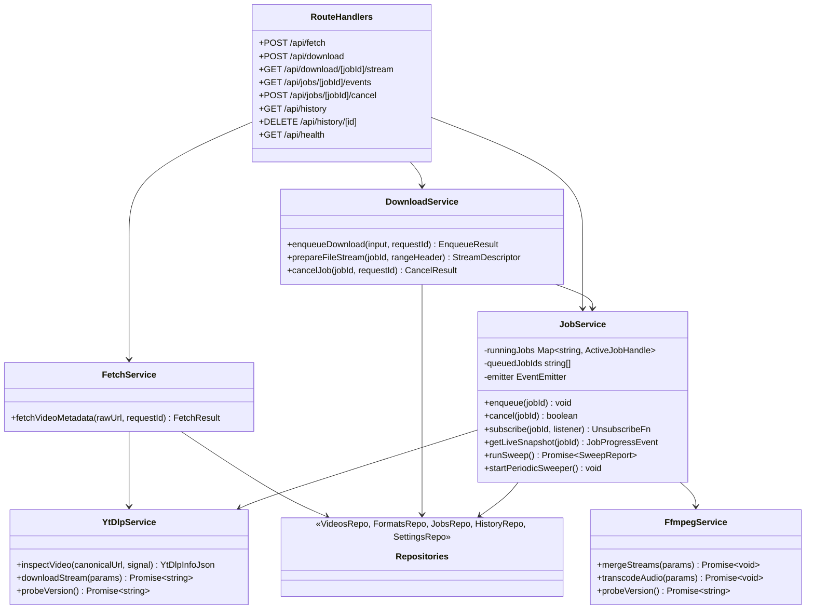
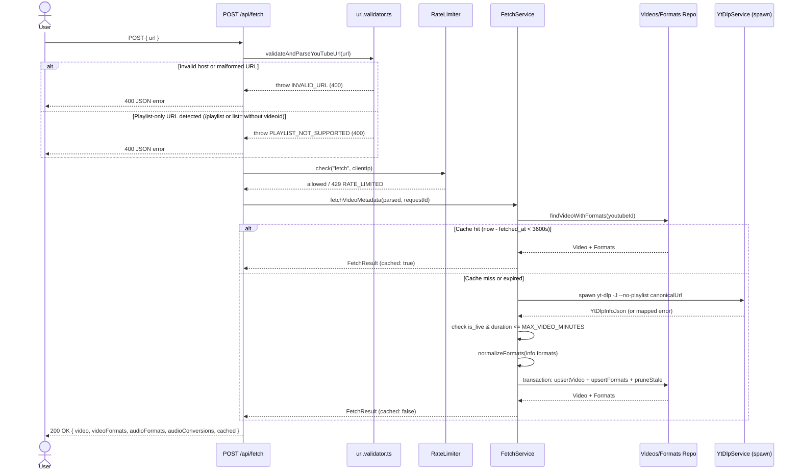
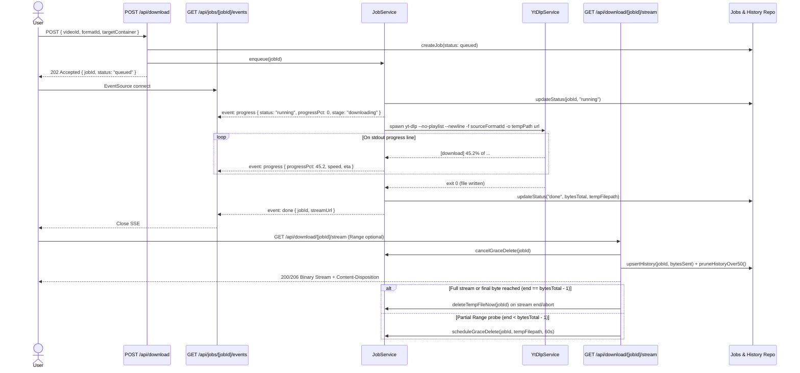
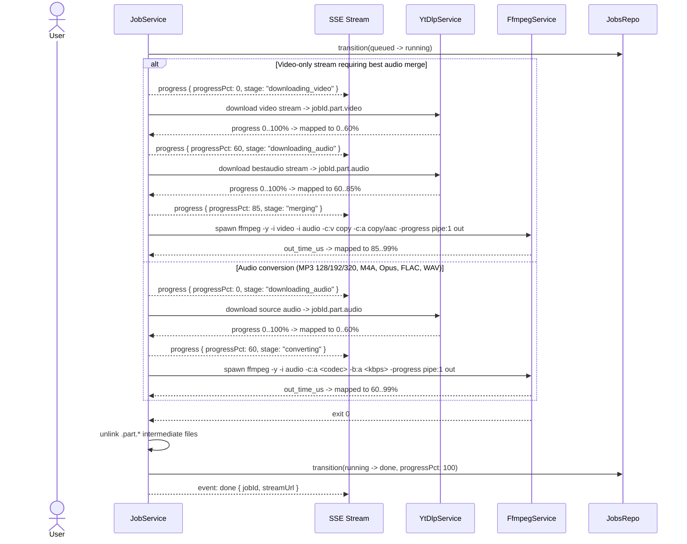
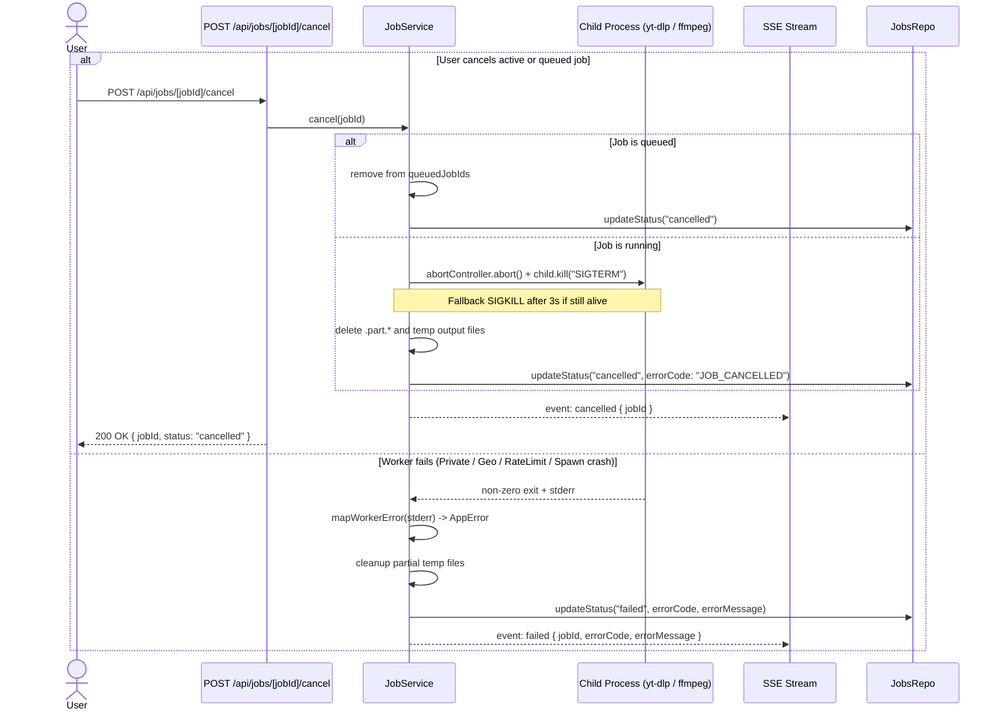
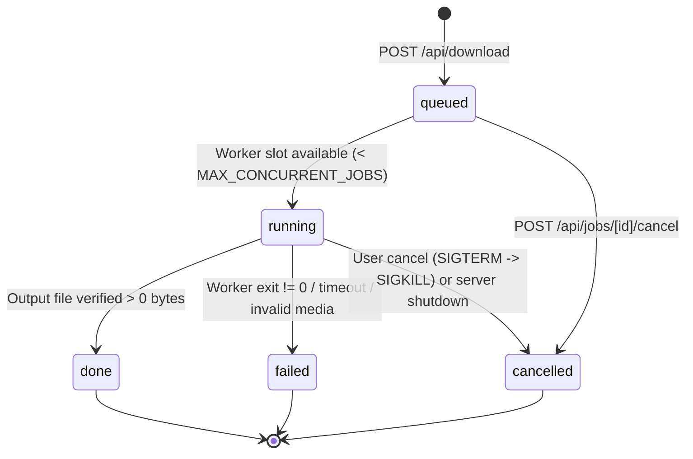

# RetroTube — Low-Level Design (LLD)

> **Status:** Design Document (Phase 1)  
> **Architecture Pattern:** Layered Next.js App Router (`Route Handlers -> Services -> Repositories -> SQLite / Child Processes`)

---

## 1. Folder Structure

```text
kisni/
├── app/
│   ├── layout.tsx                      # Root layout: Manrope + Satoshi fonts, theme script, PWA meta
│   ├── globals.css                     # Tailwind v4 tokens, Warm Cream & CRT Night CSS vars, halftone/grain
│   ├── page.tsx                        # Main screen (Server shell + Fetch/Formats/Progress Client Islands)
│   ├── history/
│   │   └── page.tsx                    # Last-50 download history view (SSR + delete / re-download actions)
│   ├── offline/
│   │   └── page.tsx                    # PWA offline fallback ("Tape not found")
│   ├── unlock/
│   │   └── page.tsx                    # Optional APP_PASSWORD login screen
│   ├── manifest.ts                     # Dynamic Web App Manifest (icons, shortcuts, share_target)
│   └── api/
│       ├── health/route.ts             # GET  /api/health
│       ├── auth/
│       │   ├── login/route.ts          # POST /api/auth/login
│       │   └── logout/route.ts         # POST /api/auth/logout
│       ├── fetch/route.ts              # POST /api/fetch
│       ├── download/
│       │   ├── route.ts                # POST /api/download
│       │   └── [jobId]/stream/route.ts # GET  /api/download/[jobId]/stream (Range + Content-Disposition)
│       ├── jobs/
│       │   └── [jobId]/
│       │       ├── events/route.ts     # GET  /api/jobs/[jobId]/events (SSE progress)
│       │       └── cancel/route.ts     # POST /api/jobs/[jobId]/cancel
│       └── history/
│           ├── route.ts                # GET  /api/history
│           └── [id]/route.ts           # DELETE /api/history/[id]
├── proxy.ts                            # Next.js 16 Proxy: requestId injection & optional APP_PASSWORD gate
├── instrumentation.ts                  # Server boot hook: run migrations, recover stale jobs, start sweeper
├── db/
│   ├── schema.ts                       # Drizzle SQLite tables, relations & indexes
│   ├── client.ts                       # Singleton better-sqlite3 connection (WAL, foreign_keys=ON)
│   └── migrate.ts                      # Programmatic Drizzle migration runner on startup
├── drizzle/
│   └── 0000_ambitious_epoch.sql        # Generated SQL migration
├── repositories/
│   ├── videos.repo.ts                  # Upsert/find videos by youtube_id or id
│   ├── formats.repo.ts                 # Upsert/prune/list formats for video_id
│   ├── jobs.repo.ts                    # Create/read/transition download_jobs & mark SERVER_RESTART
│   ├── history.repo.ts                 # Upsert history, list newest 50, delete by id, prune > 50
│   └── settings.repo.ts                # Get/set key-value settings & DB ping
├── services/
│   ├── ytdlp.service.ts                # spawn yt-dlp -J & yt-dlp download with timeout & error map
│   ├── ffmpeg.service.ts               # spawn ffmpeg for video+audio mux & audio transcoding + progress
│   ├── format.normalizer.ts            # Pure yt-dlp format JSON -> normalized Video/Audio/Conversion DTOs
│   ├── fetch.service.ts                # URL validation, 1h cache lookup, format normalization, DB sync
│   ├── job.service.ts                  # Job state machine, concurrency queue, SSE EventEmitter, kill tree, sweeper
│   ├── download.service.ts             # Job creation, stream descriptor, Range support & temp cleanup
│   ├── history.service.ts              # History listing, deletion, re-download job creation
│   └── health.service.ts               # SQLite, TEMP_DIR, yt-dlp, ffmpeg readiness checks
├── lib/
│   ├── env.ts                          # Zod-validated environment configuration with defaults
│   ├── logger.ts                       # Structured JSON logger with requestId / jobId context
│   ├── errors.ts                       # AppError hierarchy, ErrorCode enum, central JSON error mapper
│   ├── url.validator.ts                # Strict YouTube URL parser, playlist-only detector, SSRF allowlist
│   ├── filename.ts                     # Content-Disposition & OS-safe filename sanitizer
│   ├── rate-limiter.ts                 # Sliding-window in-memory per-IP rate limiter
│   ├── auth.ts                         # HMAC-SHA256 cookie sign/verify & timingSafeEqual password check
│   └── http.ts                         # Request context helper (requestId, client IP, JSON error wrapper)
├── components/
│   ├── RetroHeader.tsx                 # Header + Theme toggle + Nav links
│   ├── ThemeToggle.tsx                 # Light (Warm Cream) / Dark (CRT Night) toggle
│   ├── FetchWorkspace.tsx              # Client island: URL input, metadata card, tabs, download trigger
│   ├── FormatList.tsx                  # Video / Audio tabs, HDR/FPS badges, audio conversion picker
│   ├── JobProgressPanel.tsx            # Tape-reel loader, tracking progress bar, SSE listener, cancel
│   ├── HistoryList.tsx                 # Client island: delete & re-download actions
│   ├── InstallPrompt.tsx               # beforeinstallprompt + iOS Share->Home hint + SW registration
│   └── UnlockForm.tsx                  # Password prompt when APP_PASSWORD is enabled
├── public/
│   ├── fonts/Satoshi-*.woff2           # Self-hosted Satoshi 500, 700, 900
│   ├── icons/                          # 192x192 & 512x512 PNG icons (any + maskable)
│   └── sw.js                           # Hand-written Service Worker
├── docs/                               # HLD.md, LLD.md, ER.md, SCHEMA.md
├── tests/
│   ├── unit/                           # Vitest unit tests
│   └── e2e/                            # Playwright smoke test with mock yt-dlp
├── Dockerfile
├── docker-compose.yml
├── .env.example
└── drizzle.config.ts
```

---

## 2. Module Breakdown & Class Diagram



---

## 3. Sequence Diagrams

### 3.1 Fetch Metadata (`POST /api/fetch`)



### 3.2 Direct Download Flow



### 3.3 Merge / Audio Convert Job with SSE Progress



### 3.4 Error & Cancellation Paths



---

## 4. API Contracts

All error responses share a uniform envelope:

```json
{
  "error": {
    "code": "INVALID_URL",
    "message": "Please enter a valid YouTube video URL.",
    "requestId": "9f8c2e10-4b3b-4c4b-9e6b-87a1d88a12ab",
    "details": {}
  }
}
```

### 4.1 `POST /api/fetch`

- **Request:**
  ```json
  { "url": "https://www.youtube.com/watch?v=dQw4w9WgXcQ" }
  ```
- **Response (`200 OK`):**
  ```json
  {
    "cached": false,
    "video": {
      "id": 1,
      "youtubeId": "dQw4w9WgXcQ",
      "title": "Sample Video Title",
      "channel": "Sample Channel",
      "durationSec": 213,
      "uploadDate": "2009-10-25",
      "thumbnailUrl": "https://i.ytimg.com/vi/dQw4w9WgXcQ/hqdefault.jpg",
      "fetchedAt": 1731331200000
    },
    "videoFormats": [
      {
        "id": 12,
        "formatId": "137",
        "kind": "video",
        "container": "mp4",
        "vcodec": "avc1.640028",
        "acodec": null,
        "resolution": "1080p",
        "width": 1920,
        "height": 1080,
        "fps": 30,
        "bitrateKbps": 4200,
        "filesizeBytes": 111820800,
        "isHdr": false,
        "needsAudioMerge": true,
        "recommendedContainer": "mp4",
        "formatNote": "1080p"
      }
    ],
    "audioFormats": [
      {
        "id": 18,
        "formatId": "251",
        "kind": "audio",
        "container": "webm",
        "vcodec": null,
        "acodec": "opus",
        "bitrateKbps": 160,
        "filesizeBytes": 4260000,
        "formatNote": "medium"
      }
    ],
    "audioConversions": [
      {
        "id": "mp3-128",
        "targetContainer": "mp3",
        "bitrateKbps": 128,
        "label": "MP3 128 kbps"
      },
      {
        "id": "mp3-192",
        "targetContainer": "mp3",
        "bitrateKbps": 192,
        "label": "MP3 192 kbps"
      },
      {
        "id": "mp3-320",
        "targetContainer": "mp3",
        "bitrateKbps": 320,
        "label": "MP3 320 kbps"
      },
      { "id": "m4a", "targetContainer": "m4a", "bitrateKbps": 192, "label": "M4A (AAC)" },
      { "id": "opus", "targetContainer": "opus", "bitrateKbps": 160, "label": "Opus" },
      {
        "id": "flac",
        "targetContainer": "flac",
        "bitrateKbps": null,
        "label": "FLAC (Lossless)"
      },
      {
        "id": "wav",
        "targetContainer": "wav",
        "bitrateKbps": null,
        "label": "WAV (PCM 16-bit)"
      }
    ]
  }
  ```

### 4.2 `POST /api/download`

- **Request:**
  ```json
  {
    "videoId": 1,
    "formatId": 12,
    "targetContainer": "mp4",
    "audioBitrateKbps": null
  }
  ```
  For audio conversions, `formatId` references the chosen/best audio `formats.id`, `targetContainer` is `"mp3" | "m4a" | "opus" | "flac" | "wav"`, and `audioBitrateKbps` is `128 | 192 | 320` for MP3 (or omitted/null).
- **Response (`202 Accepted`):**
  ```json
  {
    "jobId": "c2a3a6c8-5e1e-4b3e-9a4b-6b6f16d47021",
    "status": "queued",
    "needsMerge": true,
    "outputFilename": "Sample Video Title [1080p].mp4",
    "eventsUrl": "/api/jobs/c2a3a6c8-5e1e-4b3e-9a4b-6b6f16d47021/events",
    "streamUrl": "/api/download/c2a3a6c8-5e1e-4b3e-9a4b-6b6f16d47021/stream"
  }
  ```

### 4.3 `GET /api/jobs/[jobId]/events` (SSE)

- **Headers:** `Content-Type: text/event-stream; charset=utf-8`, `Cache-Control: no-cache, no-transform`, `Connection: keep-alive`
- **Event Frames:**
  ```text
  event: progress
  data: {"jobId":"c2a3a6c8-...","status":"running","progressPct":64.5,"stage":"downloading_audio","speed":"3.2 MiB/s","etaSec":8}

  event: done
  data: {"jobId":"c2a3a6c8-...","status":"done","progressPct":100,"streamUrl":"/api/download/c2a3a6c8-.../stream","outputFilename":"Sample Video Title [1080p].mp4","bytesTotal":114502912}
  ```
  Terminal error/cancel events emit `event: failed` or `event: cancelled` and close the stream. Heartbeat comment `: keepalive\n\n` sent every 15s.

### 4.4 `GET /api/download/[jobId]/stream`

- **Supports:** `Range: bytes=<start>-<end?>`
- **Headers (`200` or `206`):**
  - `Content-Type`: mapped MIME type (`video/mp4`, `video/webm`, `video/x-matroska`, `audio/mpeg`, `audio/mp4`, `audio/opus`, `audio/flac`, `audio/wav`)
  - `Content-Disposition`: `attachment; filename="<ascii-safe>"; filename*=UTF-8''<rfc5987>`
  - `Accept-Ranges: bytes`
  - `Content-Length` and (for `206`) `Content-Range: bytes <start>-<end>/<total>`
  - `Cache-Control: private, no-store`

### 4.5 `POST /api/jobs/[jobId]/cancel`

- **Response (`200 OK`):**
  ```json
  { "jobId": "c2a3a6c8-5e1e-4b3e-9a4b-6b6f16d47021", "status": "cancelled" }
  ```

### 4.6 `GET /api/history` & `DELETE /api/history/[id]`

- **`GET /api/history` (`200 OK`):**
  ```json
  {
    "items": [
      {
        "id": 7,
        "jobId": "c2a3a6c8-5e1e-4b3e-9a4b-6b6f16d47021",
        "downloadedAt": 1731331350000,
        "bytesSent": 114502912,
        "outputFilename": "Sample Video Title [1080p].mp4",
        "targetContainer": "mp4",
        "targetBitrateKbps": null,
        "sourceFormatId": "137",
        "video": {
          "id": 1,
          "youtubeId": "dQw4w9WgXcQ",
          "title": "Sample Video Title",
          "channel": "Sample Channel",
          "durationSec": 213,
          "thumbnailUrl": "https://i.ytimg.com/vi/dQw4w9WgXcQ/hqdefault.jpg"
        },
        "formatId": 12
      }
    ]
  }
  ```
- **`DELETE /api/history/[id]` (`200 OK`):**
  ```json
  { "deleted": true, "id": 7 }
  ```

### 4.7 `GET /api/health`

- **Response (`200 OK` healthy / `503 Service Unavailable` degraded):**
  ```json
  {
    "status": "ok",
    "timestamp": "2026-11-11T13:25:00.000Z",
    "checks": {
      "db": { "ok": true },
      "tempDir": { "ok": true, "path": "/app/tmp" },
      "ytdlp": { "ok": true, "version": "2026.10.01" },
      "ffmpeg": { "ok": true, "version": "7.1" }
    },
    "activeJobs": 0,
    "queuedJobs": 0
  }
  ```

### 4.8 Optional Auth (`POST /api/auth/login`, `POST /api/auth/logout`)

- **`POST /api/auth/login`:** `{ "password": "..." }` -> `200 OK { "authenticated": true }` + `Set-Cookie: retrotube_session=...; HttpOnly; SameSite=Strict; Path=/; Max-Age=604800` (or `401 UNAUTHORIZED`).
- **`POST /api/auth/logout`:** clears `retrotube_session` cookie (`200 OK`).

---

## 5. Job State Machine



### Transition Guards

- Only `queued` may transition to `running`.
- Only `queued` or `running` may transition to `cancelled`.
- Terminal states (`done`, `failed`, `cancelled`) are immutable; cancel calls on already-terminal jobs return `409 INVALID_JOB_STATE` (or idempotent `200` if already `cancelled`).
- On server boot (`instrumentation.ts`), any leftover `queued` or `running` rows in SQLite from an unclean crash are transitioned to `failed` (`error_code = 'SERVER_RESTART'`).

---

## 6. Error Code Catalogue

| Error Code               | HTTP Status | Trigger / Detection                                                | User-Friendly Message                                                                    |
| :----------------------- | :---------- | :----------------------------------------------------------------- | :--------------------------------------------------------------------------------------- |
| `VALIDATION_ERROR`       | `400`       | Zod schema validation failure                                      | Request input is invalid.                                                                |
| `INVALID_URL`            | `400`       | Non-YouTube host, bad protocol, or missing 11-char ID              | Please enter a valid YouTube link (youtube.com, youtu.be, shorts, or music.youtube.com). |
| `PLAYLIST_NOT_SUPPORTED` | `400`       | Playlist-only URL (`/playlist` or `list=` without video ID)        | Playlist URLs are not supported in v1. Please pick a single video URL.                   |
| `UNAUTHORIZED`           | `401`       | Missing/invalid session cookie when `APP_PASSWORD` is set          | Password required to access RetroTube.                                                   |
| `JOB_NOT_FOUND`          | `404`       | Unknown `jobId` or `history` id                                    | Download job or history entry was not found.                                             |
| `INVALID_JOB_STATE`      | `409`       | Streaming an unfinished job or cancelling a completed job          | Job is not in a valid state for this operation.                                          |
| `FILE_EXPIRED`           | `410`       | Temp output file already cleaned up or expired                     | Downloaded file has expired from temporary storage. Please re-download.                  |
| `VIDEO_TOO_LONG`         | `422`       | `durationSec > MAX_VIDEO_MINUTES * 60`                             | This video exceeds the maximum configured duration limit.                                |
| `LIVE_STREAM`            | `422`       | `is_live === true` or `live_status === "is_live"`                  | Live streams cannot be downloaded while broadcasting.                                    |
| `PRIVATE_VIDEO`          | `403`       | yt-dlp stderr matches private video                                | This video is private and cannot be accessed.                                            |
| `AGE_RESTRICTED`         | `403`       | yt-dlp stderr matches age verification prompt                      | This video is age-restricted and cannot be fetched without sign-in.                      |
| `GEO_BLOCKED`            | `451`       | yt-dlp stderr matches country restriction                          | This video is unavailable in the server's region.                                        |
| `VIDEO_UNAVAILABLE`      | `404`       | yt-dlp stderr matches removed/unavailable video                    | This video is unavailable or has been removed.                                           |
| `RATE_LIMITED`           | `429`       | Per-IP sliding window limit OR YouTube HTTP 429 / bot check        | Too many requests right now. Please wait a moment and try again.                         |
| `QUEUE_FULL`             | `429`       | Active + queued jobs exceed queue cap (`MAX_CONCURRENT_JOBS * 5`)  | Download queue is currently busy. Please wait for an active job to finish.               |
| `TIMEOUT`                | `504`       | `yt-dlp` or `ffmpeg` process exceeded configured execution timeout | Media processing timed out. Please try again.                                            |
| `YTDLP_FAILED`           | `502`       | Other non-zero `yt-dlp` exit or malformed JSON                     | Failed to fetch or download media via yt-dlp.                                            |
| `FFMPEG_FAILED`          | `500`       | Non-zero `ffmpeg` exit during merge or conversion                  | Failed to merge or convert media streams via ffmpeg.                                     |
| `SERVER_RESTART`         | `500`       | Job was running/queued when server restarted                       | Job was interrupted by a server restart. Please retry.                                   |
| `JOB_CANCELLED`          | `200/499`   | Job aborted by user via cancel endpoint                            | Download was cancelled.                                                                  |
| `INTERNAL_ERROR`         | `500`       | Unhandled server exception                                         | An unexpected error occurred. Check server logs with the request ID.                     |

---

## 7. Temp-File Lifecycle & Cleanup

1. **Naming & Isolation:** Every job writes solely inside `<TEMP_DIR>` using its server-generated UUID `jobId`:
   - Intermediate streams (when merging/converting): `<TEMP_DIR>/<jobId>.part.video`, `<TEMP_DIR>/<jobId>.part.audio`
   - Final deliverable: `<TEMP_DIR>/<jobId>.<targetContainer>`
2. **Immediate Cleanup Triggers:**
   - As soon as `ffmpeg` exits `0` for merge/convert jobs, `.part.video` and `.part.audio` are unlinked immediately.
   - On `failed` or `cancelled`, all files matching `<jobId>.*` in `TEMP_DIR` are unlinked immediately and `temp_filepath` is set to `NULL`.
3. **Stream End / Abort & Range-Safe Cleanup:**
   - On full downloads (`200 OK`, no `Range` header) or a `Range` response that reaches the final byte (`end === fileSize - 1`), the temp file is unlinked immediately when the response stream ends or aborts.
   - When a client sends a tiny `Range` probe (`end < fileSize - 1`, e.g., `bytes=0-1`), a 60-second grace timer is scheduled instead (and cancelled when the full request arrives) so multi-range downloads do not fail prematurely.
4. **30-Minute Periodic Sweeper + Startup Recovery:**
   - Every 30 minutes (`1_800_000 ms`), `JobService.runSweep()` scans `TEMP_DIR` and unlinks any file older than `30 minutes` whose job is not `running`, clearing `download_jobs.temp_filepath = NULL`.
   - On server startup (`instrumentation.ts`), any unreferenced files in `TEMP_DIR` older than 30 minutes (or matching crashed `running`/`queued` jobs) are cleaned up automatically.
